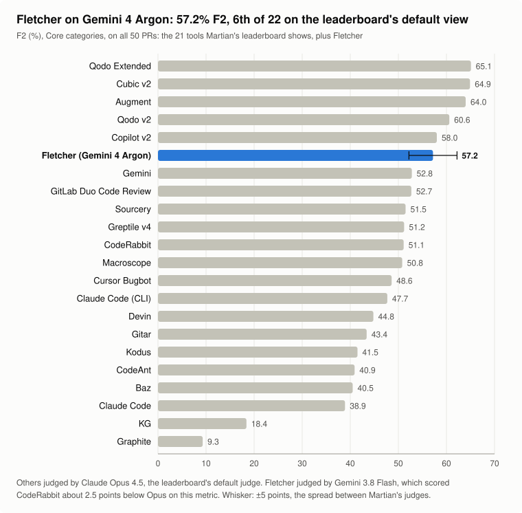
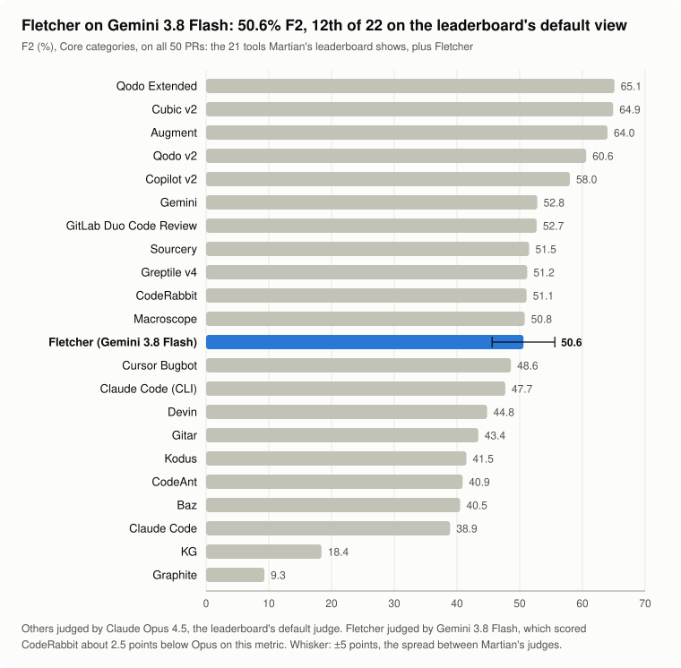

# Fletcher on Martian's code review benchmark

[Fletcher](https://github.com/shahparshva72/not-quite-my-tempo), an AI pull request reviewer, was run on all 50 PRs of [Martian's offline code review benchmark](https://github.com/withmartian/code-review-benchmark) with two models. It was scored the way the [leaderboard](https://codereview.withmartian.com/?mode=offline&ob=2) scores by default (Core categories, F2) and placed against the 21 tools the leaderboard shows:

| Model | F2 | Rank under Claude Opus 4.5 (leaderboard default) | Rank under Claude Sonnet 4.5 | Review cost, 50 PRs |
| --- | --- | --- | --- | --- |
| `gemini-4-argon` (pro tier) | **57.2%** | **6th of 22** | 3rd of 22 | $9.61 (about $0.19 per PR) |
| `gemini-3.8-flash` (flash tier) | **50.6%** | **12th of 22** | 7th of 22 | $4.25 (about $0.085 per PR) |

Both ran on Vertex AI on 17 October 2026 against Martian commit `e616e84`, with the same prompt and production review path; only the model changed. Judging cost about $0.85 for both runs. The leaderboard numbers come from Martian's own `analysis/benchmark_dashboard.py`.





## Results

Martian's leaderboard scores with **F2**, which counts recall as twice as important as precision, because a missed bug costs more than a false alarm. It also uses the **Core** profile by default, which leaves out golden comments about style and speculation.

| Model | Profile | Precision | Recall | F1 | F2 |
| --- | --- | --- | --- | --- | --- |
| Gemini 4 Argon | **Core** (leaderboard default) | 43.8% (98 of 224) | 62.0% (98 of 158) | 51.3% | **57.2%** |
| Gemini 4 Argon | All categories | 45.5% (105 of 231) | 60.7% (105 of 173) | 52.0% | 56.9% |
| Gemini 3.8 Flash | **Core** (leaderboard default) | 50.6% (80 of 158) | 50.6% (80 of 158) | 50.6% | **50.6%** |
| Gemini 3.8 Flash | All categories | 52.1% (85 of 163) | 49.1% (85 of 173) | 50.6% | 49.7% |

Where each Core score would place among the 21 leaderboard tools, under each of Martian's judges:

| Judge | Argon, F2 | Argon, F1 | Flash, F2 | Flash, F1 |
| --- | --- | --- | --- | --- |
| Claude Opus 4.5 (leaderboard default) | 6th of 22 | 9th of 22 | 12th of 22 | 10th of 22 |
| Claude Sonnet 4.5 | 3rd of 22 | 5th of 22 | 7th of 22 | 6th of 22 |
| GPT-5.2 | 5th of 22 | 5th of 22 | 6th of 22 | 5th of 22 |

Both runs were judged by Gemini 3.8 Flash, which on this metric scored CodeRabbit about 2.5 points below Opus and Sonnet (48.5% vs 51.1% and 50.9%). If that holds for Fletcher too, these ranks understate it slightly.

Argon's gain comes from recall: it finds 18 more of the 158 Core issues than Flash, but adds 48 more findings that aren't in the golden set, so fewer than half its findings are real. Flash's precision and recall are equal; its prompt asks for "a few high-signal findings over volume", which F1 rewards and F2 does not. On plain F1 over all categories and all 49 tools in Martian's data, hidden versions included, either model would rank 4th ([chart](charts/ranking-f1-all-tools.svg)).


Per-PR numbers for both models are in [`data/fletcher-per-pr.csv`](data/fletcher-per-pr.csv). Every review Fletcher wrote, with the golden comments and the judge's reasoning for each match, is in [`data/fletcher-reviews.json`](data/fletcher-reviews.json), keyed by PR and then by tool (`fletcher-gemini-4-argon`, `fletcher-gemini-3.8-flash`).

## Is the comparison fair?

Mostly, within about ±5 points. Martian's published scores were judged by Claude Opus 4.5, Claude Sonnet 4.5 and GPT-5.2. This run used Gemini 3.8 Flash as the judge, because the only budget available was Vertex AI credits. To check whether Gemini grades differently, two competitors' existing reviews were re-judged with it:


Gemini scored CodeRabbit 0.8 points and Greptile v5 1.5 points below Sonnet 4.5. Martian's own three judges disagree with each other by about 5 points on the same tool. So Fletcher's score carries a ±5-point error bar against the leaderboard. Under the identical Gemini judge, Fletcher on Flash (50.6% F1) and on Argon (52.0%) both beat CodeRabbit (42.7%) and Greptile v5 (39.3%) outright. All-category scores for every tool under all four judges are in [`data/scores-by-judge.json`](data/scores-by-judge.json), and the leaderboard's Core-profile numbers in [`data/leaderboard-core.json`](data/leaderboard-core.json).

## How it was run

Nothing was posted to GitHub, and no repositories were forked.

1. **Reviews.** [`harness/review.ts`](harness/review.ts) reads each benchmark PR from Martian's public copies through the GitHub API. It runs Fletcher's production review path (the same diff filter, repository context, prompt and comment formatting) against Vertex AI, then writes the review into Martian's `results/benchmark_data.json` as one more tool.
2. **Judging.** Martian's unmodified pipeline extracts the issues in each review, groups duplicates, and asks an LLM judge whether each issue matches a golden comment. It speaks the OpenAI API, so [`harness/judge-proxy.ts`](harness/judge-proxy.ts) serves that API on localhost and forwards every call to Gemini on Vertex AI.
3. **Scoring.** Martian's `analysis/benchmark_dashboard.py` computes the leaderboard numbers (Core profile, F2, hidden tools removed). [`analysis/build.py`](analysis/build.py) also pools true positives, false positives and misses across all 50 PRs for the all-category figures, exports `data/` and draws `charts/`.

The harness imports Fletcher's internals, so it only runs from inside the [not-quite-my-tempo](https://github.com/shahparshva72/not-quite-my-tempo) repository (`apps/api/scripts/martian-bench/`). The copy here is for reference; [`harness/HARNESS.md`](harness/HARNESS.md) has the full run guide.

To regenerate the data and charts from a Martian checkout that holds the run:

```sh
cd ~/path/to/code-review-benchmark/offline
uv run python analysis/benchmark_dashboard.py --output /tmp/dash.html
cd -
python3 analysis/build.py --martian ~/path/to/code-review-benchmark --dashboard /tmp/dash.json
```

## Caveats

- **Different judge.** See above: treat each score as ±5 points. Under the default Opus judge that spans roughly 4th to 8th of 22 for Argon and 6th to 14th for Flash.
- **Self-preference.** A Gemini judge scoring a Gemini-written review may favour it a little. The calibration check covers this only partly.
- **Incomplete golden set.** Some findings counted as false positives look like real bugs the human reviewers didn't list. That lowers precision for every tool alike.
- **Training leakage.** The PRs are public, so models may have seen them or their fixes.
- **One run per model.** Reviews and judging were each run once per model, so run-to-run variance is unknown, and part of the gap between the two models may be noise.
- **Timeouts.** In the Flash run, 3 of 50 reviews failed on the first pass, and one PR (keycloak#38446) exceeded Fletcher's then 180-second timeout twice and was reviewed with a 360-second limit. Production now allows 420 seconds, which the Argon run used; all 50 Argon reviews passed first time.

## What Fletcher missed

In the 5-PR smoke test, half of Fletcher's 10 misses were concurrency bugs (3) or test gaps (2): races on shared caches, processes left running after a deadline, and a monkeypatched `sleep` that turns a test's wait into a no-op. These are the targets for the next prompt iteration.

## Credits and licence

The benchmark data, golden comments, judge pipeline and other tools' evaluations come from [withmartian/code-review-benchmark](https://github.com/withmartian/code-review-benchmark), MIT-licensed. Its licence is included in [`third_party/`](third_party/martian-code-review-benchmark-LICENSE).
